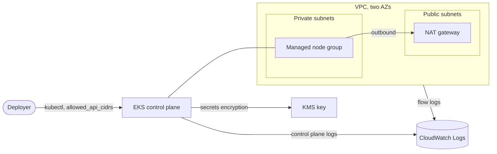

# AWS Managed Kubernetes (EKS)

An EKS cluster with a managed node group in private subnets.

OpenTofu demo template. Standalone, no dependency on other repos. Compatible with Terraform.

## Architecture



- VPC across two AZs: public subnets (NAT gateway and internet-facing load balancers only) and private subnets
- One NAT gateway for outbound traffic of the nodes
- EKS cluster with control plane logging and secrets encryption (KMS)
- Managed node group in the private subnets with a hardened launch template
- EKS Pod Identity agent add-on
- Access entry that makes the deploying IAM role cluster admin
- VPC flow logs

No sample workload is deployed.

## Security

- Nodes in private subnets without public IPs
- Public API endpoint limited to `allowed_api_cidrs` (required, `0.0.0.0/0` is rejected), private endpoint access on
- Kubernetes secrets encrypted with a customer-managed KMS key, key rotation on
- Control plane logs (api, audit, authenticator, controllerManager, scheduler) with a retention period
- Authentication mode `API` (access entries only, no `aws-auth` ConfigMap), no implicit admin for the cluster creator
- Nodes: IMDSv2 enforced with hop limit 1, encrypted gp3 volumes. Pods use EKS Pod Identity instead of node credentials
- Default security group of the VPC has no rules, VPC flow logs capture all traffic

Accepted checkov findings (documented inline in the code):

| Check | Reason |
|---|---|
| CKV_AWS_38, CKV_AWS_39 | The public endpoint is needed for kubectl from outside the VPC. It is limited to `allowed_api_cidrs`, and a validation rejects `0.0.0.0/0` |
| CKV_AWS_338, CKV_AWS_158 | Log retention is configurable, AWS-managed encryption for logs |
| CKV_AWS_394 | Only the first two zones are used |

## Usage

Configure AWS credentials, for example with `aws configure sso` or environment variables.

```bash
cp terraform.tfvars.example terraform.tfvars
tofu init
tofu plan
tofu apply
```

## Access

The identity that runs OpenTofu becomes cluster admin through an access entry. From an IP in `allowed_api_cidrs`:

```bash
aws eks update-kubeconfig --name <cluster_name> --region <region>
kubectl get nodes
```

To give other people access, add access entries (`aws_eks_access_entry`) for their IAM roles.


## Inputs

| Name | Description | Default |
|---|---|---|
| `name_prefix` | Prefix for all resource names | `"demo"` |
| `region` | AWS region | `"eu-central-1"` |
| `tags` | Additional tags for all resources | `{}` |
| `allowed_api_cidrs` | CIDRs allowed to reach the API endpoint (required, `/0` rejected) | none |
| `vpc_cidr` | CIDR block of the VPC | `"10.0.0.0/16"` |
| `kubernetes_version` | Kubernetes version, `null` uses the EKS default | `null` |
| `node_instance_types` | Instance types of the node group | `["t3.medium"]` |
| `node_desired_size` | Desired number of nodes | `2` |
| `node_min_size` | Minimum number of nodes | `1` |
| `node_max_size` | Maximum number of nodes | `3` |
| `node_disk_size` | Node root volume in GiB | `20` |
| `log_retention_days` | Control plane and flow log retention | `90` |

## Outputs

| Name | Description |
|---|---|
| `cluster_name` | Name of the EKS cluster |
| `cluster_endpoint` | Endpoint of the Kubernetes API |
| `cluster_version` | Kubernetes version |
| `node_group_name` | Name of the managed node group |
| `kubeconfig_command` | Command to add the cluster to your kubeconfig |
| `vpc_id` | VPC ID |

## Cost

The EKS control plane, the NAT gateway and the nodes are billed hourly, also when idle. The KMS key, CloudWatch Logs and the Elastic IP of the NAT gateway add small monthly costs. Creating the cluster takes about 15 minutes.

**Destroy after the demo:**

```bash
tofu destroy
```

## Tests

The GitLab pipeline (`.gitlab-ci.yml`) lints every push. Merge requests into `development` or `main` also run
validation, the checkov scan and the unit tests. A tag runs all of these plus the integration tests, which deploy
real resources and destroy them again, and then creates a release. Integration tests run only when the CI/CD variable `AWS_ROLE_ARN` is set: an IAM role trusted for GitLab OIDC with the audience `sts.amazonaws.com`. `AWS_REGION` is optional.

The GitHub Actions workflow (`.github/workflows/ci.yml`) runs the same jobs: every push, pull requests into `development` or `main`, and tags. Set `AWS_ROLE_ARN` (and optionally `AWS_REGION`) as repository variables; the IAM role then needs a trust for GitHub OIDC (`token.actions.githubusercontent.com`).

```bash
tofu test -test-directory=tests/unit
```

Test cases: [tests/README.md](tests/README.md)

## Development

```bash
pre-commit install
pre-commit run --all-files
```
